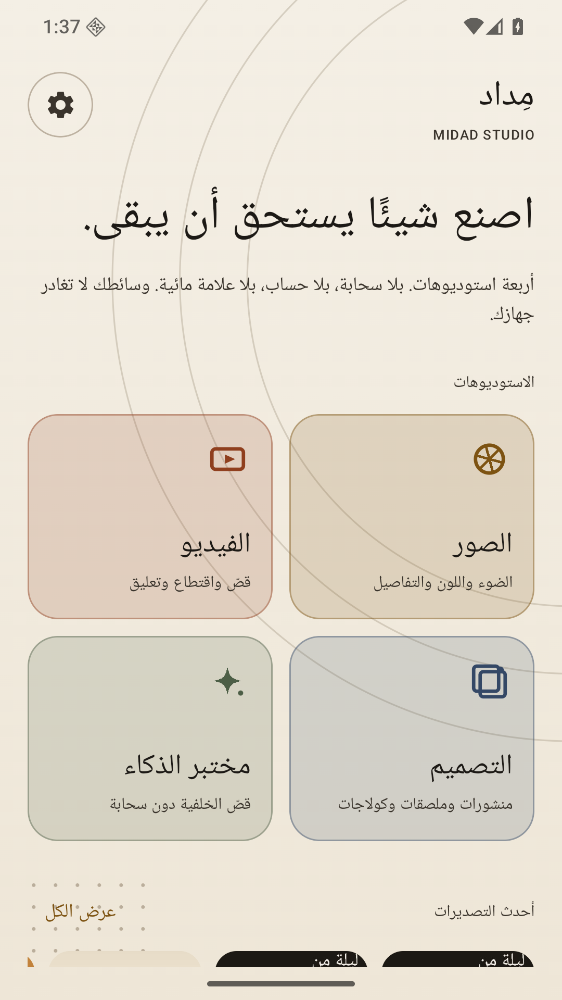
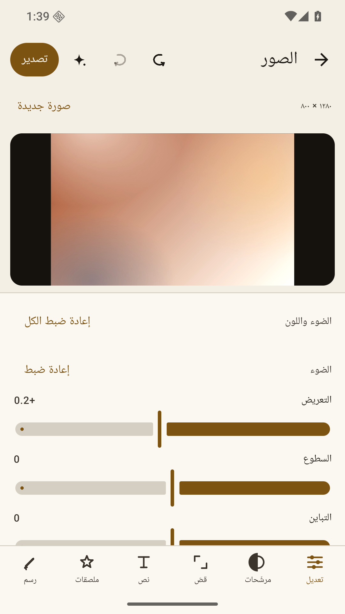
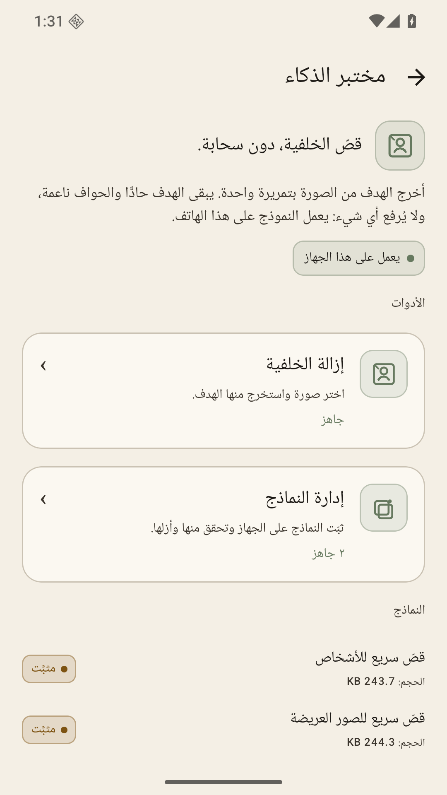
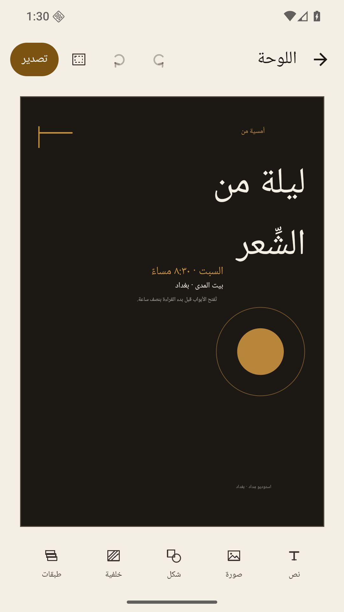
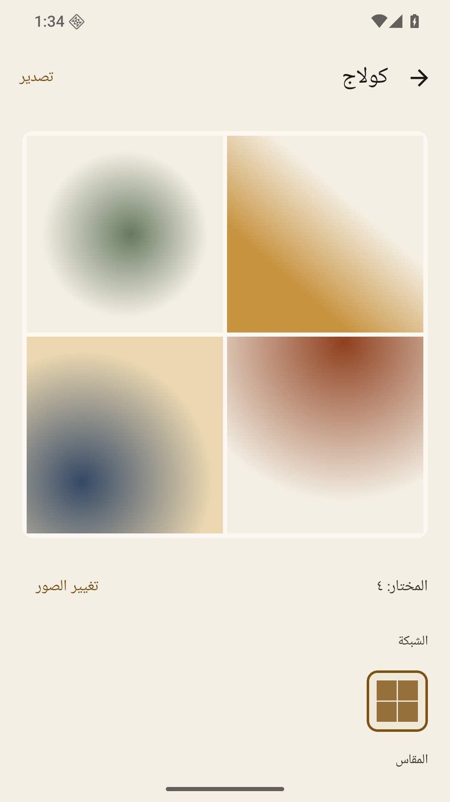
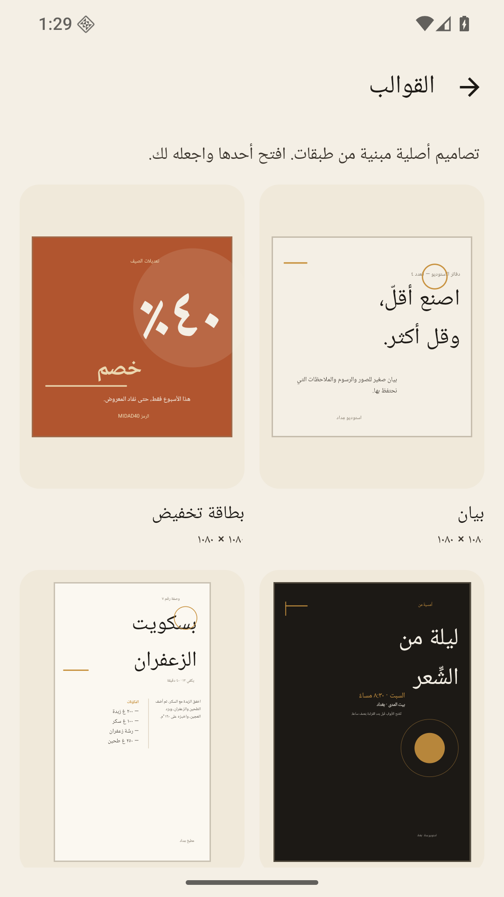
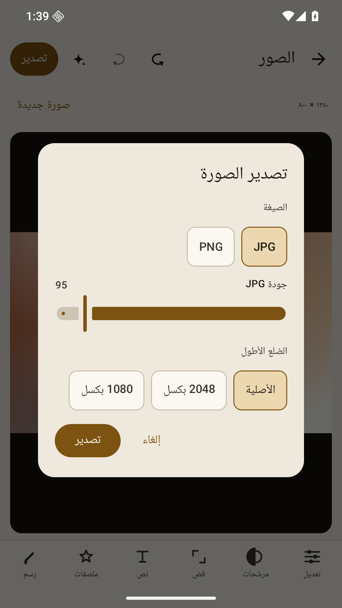
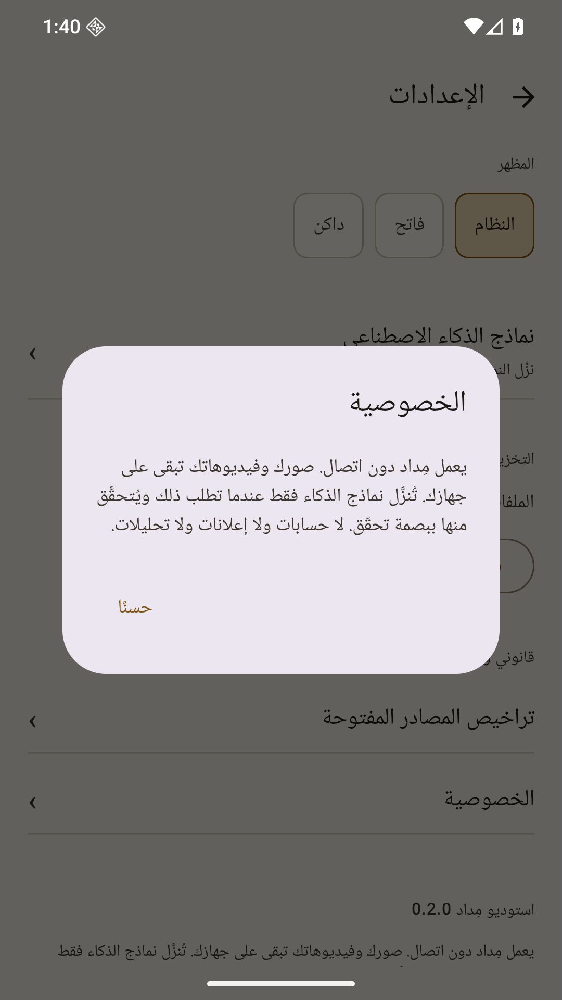

<div align="center">

# استوديو مِداد — Midad Studio

**استوديو إبداعي خاص على أندرويد يعمل دون إنترنت: محرر صور وتطبيق تصميم وصانع كولاج ومحرر فيديو وإزالة الخلفية بالذكاء الاصطناعي على الجهاز — تطبيق واحد بلا حساب، بدون إعلانات وبلا رفع لملفاتك.**

[](https://developer.android.com/about/versions/oreo)

[](https://github.com/ahmadmhmdsy/midad-studio/releases/tag/v0.2.3)
[](LICENSE)
[](https://github.com/ahmadmhmdsy/midad-studio/releases)

[English](README.md) · [العربية](README.ar.md)

</div>

> [!IMPORTANT]
> **نسخة ما قبل الإصدار: v0.2.3، وليست على Google Play.** هذه **نسخة موقّعة تُوزَّع مباشرة** (versionCode 5، بُنيت
> في 22 نوفمبر 2026). **التطبيق ليس على Google Play بعد ولم يُقدَّم أي شيء إلى Play Console.** جُرّب على محاكيات
> أندرويد، **وليس على جهاز حقيقي**، واسم «Midad Studio / استوديو مِداد» **اسم مؤقت**. نزّله من
> [إصدارات GitHub](https://github.com/ahmadmhmdsy/midad-studio/releases).

<div dir="rtl">

## نظرة عامة

استوديو مِداد تطبيق **محرر صور على أندرويد يعمل دون إنترنت**، ويجمع في تطبيق واحد محرر فيديو وصانع كولاج
واستوديو تصميم وقوالب و**مزيل خلفية بالذكاء الاصطناعي على الجهاز** بدل خمسة تطبيقات. وكلمة «مِداد» تعني الحبر،
وقد بُني التطبيق حول مساحة عمل من الورق والحبر: ورق دافئ، وحبر داكن، وأربعة ألوان هادئة.

كل ما يُعدَّل أو يُرسم أو يُصدَّر يجري **على هاتفك**. والواجهة **عربية أولاً** — محرر صور عربي حقيقي بتخطيط من
اليمين إلى اليسار، وطبقات نص عربية، وتنسيق أرقام يراعي اللغة — مع ترجمة إنجليزية كاملة، لا ترجمة ملصقة. وفوق
الاستوديوهات **مشاريع قابلة للتعديل**، ومدير نماذج لمختبر الذكاء، و**بطاقة نتيجة تصدير** واحدة تخبرك أين حُفظ
ملفك. بُني التطبيق بـ Kotlin وJetpack Compose، ويستخدم Media3 Transformer لتصدير الفيديو وLiteRT للاستدلال على
الجهاز.

## المحتويات

- [نظرة عامة](#نظرة-عامة)
- [المزايا](#المزايا)
- [لقطات الشاشة](#لقطات-الشاشة)
- [التنزيل والتثبيت](#التنزيل-والتثبيت)
- [الخصوصية وسلامة البيانات](#الخصوصية-وسلامة-البيانات)
- [البناء من المصدر](#البناء-من-المصدر)
- [لمحة عن البنية](#لمحة-عن-البنية)
- [الحدود المعروفة](#الحدود-المعروفة)
- [الأسئلة الشائعة](#الأسئلة-الشائعة)
- [المساهمة والأمان](#المساهمة-والأمان)
- [الترخيص](#الترخيص)
- [روابط](#روابط)

## المزايا

### أربعة استوديوهات ومختبر ذكاء واحد

| الاستوديو | ما يمكنك فعله |
|---|---|
| **الصور** (محرر الصور) | التعريض والتباين والإبرازات والظلال وحرارة اللون والتشبّع والتفاصيل؛ مظاهر بأسلوب الأفلام الأصلية؛ القص والتدوير والتسوية؛ طبقات نص عربية وإنجليزية وملصقات ورسم حر؛ التراجع والإعادة؛ تصدير JPEG أو PNG بضلع أطول تختاره (الأصلية أو 2048 أو 1080 بكسل). |
| **الفيديو** (محرر الفيديو) | حتى 5 مقاطع و3 دقائق للمشروع الواحد؛ قص المقاطع وإعادة ترتيبها وإضافة مظهر لوني ونسبة إطار وعنوان، ثم تصدير MP4 على الجهاز عبر Media3. وتعرض المعاينة الكاملة للمشروع التركيب نفسه الذي يكتبه المصدّر، بنسخة معاينة بدقة 960 بكسل. |
| **التصميم** (تطبيق تصميم وقوالب) | لوحات فارغة (منشور، ستوري، أفقي، A4) و**7 قوالب أصلية متعددة الطبقات** — بيان، بطاقة تخفيض، ملصق مناسبة، بطاقة وصفة، ملصق منتج بسيط، عد تنازلي للستوري، بطاقة عنوان. أضف طبقات صور ونصوص وأشكال، وحرّكها وكبّرها ودوّرها، ثم صدّر PNG أو JPEG. |
| **الكولاج** (صانع الكولاج) | أنشئ كولاجاً من صورك بتخطيطات وهوامش ورقية، ثم صدّر الشبكة كاملة مرة واحدة. |
| **مختبر الذكاء** (مزيل الخلفية) | أزل خلفية الصورة أو ضبّبها أو استبدلها **على الجهاز** بكتالوج من ستة نماذج: نموذجان مضمّنان للعمل دون إنترنت وأربعة تُنزَّل عند الطلب. |
| **المشاريع** | احفظ جلسة قابلة للتعديل في الصور أو التصميم أو قصّ الذكاء أو الفيديو، ثم أعد فتحها وأعد تسميتها واحذفها. المشاريع محلية وخاصة بالتطبيق، ومشاريع الفيديو تلتزم بحد 5 مقاطع و3 دقائق. |
| **بطاقة نتيجة التصدير** | بعد كل عملية تصدير تعرض بطاقة واحدة معاينة واسم الملف ومكان الحفظ و**فتح / مشاركة / إغلاق** — السطح نفسه في كل استوديو. |

### نماذج الذكاء الاصطناعي على الجهاز

نموذجان مضمّنان لتعمل إزالة الخلفية **دون إنترنت من أول تشغيل**، وتُنزَّل النماذج الأربعة الأخرى فقط عند طلبها. كل
نموذج مرخّص لهذا الاستخدام، ويُتحقق من بصمة SHA-256 الخاصة به قبل تحميله.

| النموذج | مصدره | الحجم | الأنسب لـ |
|---|---|---|---|
| مقطّع السيلفي من MediaPipe (مربع) | مضمّن في التطبيق | 243.7 كيلوبايت | الأشخاص أمام خلفية واضحة |
| مقطّع السيلفي من MediaPipe (أفقي) | مضمّن في التطبيق | 244.3 كيلوبايت | الشيء نفسه، مع تأطير أفقي |
| MediaPipe Selfie Multiclass | تنزيل | 15.6 ميغابايت | الأشخاص مع فئات الشعر والبشرة والملابس |
| مقطّع الشعر من MediaPipe | تنزيل | 763.3 كيلوبايت | الشعر فقط |
| DeepLab-V3 | تنزيل | 2.78 ميغابايت | الأجسام العامة والحيوانات الأليفة والمنتجات والمشاهد — وليس البورتريه |
| MODNet لتقطيع البورتريه | تنزيل | 24.96 ميبيبايت | البورتريه بحواف شعر ناعمة — للبورتريه فقط |

التنزيلات عبارة عن طلب HTTPS <code>GET</code> تبدأه أنت، دون حساب أو معرّف للجهاز أو حدث استخدام مرفق؛ ويُتحقق
من كل ملف قبل استخدامه ويُحفظ في مساحة خاصة بالتطبيق. لا شيء يُنزَّل في الخلفية، ولا يغادر أي نموذج الجهاز.
التفاصيل: [docs/research/MODEL_CATALOGUE.md](docs/research/MODEL_CATALOGUE.md) و
[docs/product/MODEL_LICENSES.md](docs/product/MODEL_LICENSES.md).

## لقطات الشاشة

| الرئيسية | محرر الصور | مختبر الذكاء | التصميم |
|---|---|---|---|
|  |  |  |  |
|  |  |  |  |

*اللقطات مأخوذة من نسخة 0.2.0 قبل الإصدار (versionCode 2)، وقد تختلف تفاصيل صغيرة في v0.2.3 — منها تنسيق
الأرقام وأسماء أحجام التصدير. ولقطات v0.2.3 بواجهة إنجليزية في
[docs/store/screenshots-v023/](docs/store/screenshots-v023/)، مع دليل الأصول والبصمات في
[docs/store/README.md](docs/store/README.md).*

## التنزيل والتثبيت

التنزيل الرسمي الوحيد هو **ملف APK الموقّع** الموجود في صفحة [إصدار v0.2.3 على GitHub](https://github.com/ahmadmhmdsy/midad-studio/releases/tag/v0.2.3).
**Google Play: ليس بعد** — لم يُقدَّم التطبيق إلى Play Console، فلا توجد صفحة رسمية على المتجر.

| الملف | ما هو | الحجم | SHA-256 |
|---|---|---|---|
| [Midad-Studio-0.2.3-release.apk](https://github.com/ahmadmhmdsy/midad-studio/releases/latest/download/Midad-Studio-0.2.3-release.apk) | ملف APK موقّع — وهو الملف الذي تثبّته | 22,072,532 بايت (≈21.1 ميبيبايت) | <code>AA7674D51EB1A966A9714B14DFEA635DB8DA079D88E84E159FE70D8B4D2FA76D</code> |
| Midad-Studio-0.2.3-release.aab | حزمة تطبيق أندرويد (AAB) موقّعة — لأدوات المتجر، ولا تُثبَّت مباشرة | 15,480,566 بايت (≈14.8 ميبيبايت) | <code>5BF7B419DB0370ABE34F3E7091BB083BE246C2CA14B1DD0B04C77BEDD17EF903</code> |

**المتطلبات:** أندرويد 8.0 (API 26) أو أحدث؛ جهاز بمعمارية arm64-v8a أو armeabi-v7a أو x86_64. ملف APK موقّع
وليس بناء تصحيح.

1. نزّل <code>Midad-Studio-0.2.3-release.apk</code> من صفحة الإصدار.
2. تحقّق من الملف مقابل بصمة SHA-256 أعلاه: <code>sha256sum Midad-Studio-0.2.3-release.apk</code> على لينكس
   أو macOS، أو <code>Get-FileHash Midad-Studio-0.2.3-release.apk -Algorithm SHA256</code> في PowerShell.
3. افتح الملف على الهاتف وأكّد التثبيت. سيطلب أندرويد السماح بالتثبيت من المتصفح أو مدير الملفات في المرة
   الأولى (الإعدادات ← التطبيقات ← الوصول الخاص ← تثبيت تطبيقات غير معروفة).
4. عبر USB من حاسوب:

<div dir="ltr">

```bash
adb install -r Midad-Studio-0.2.3-release.apk
```

</div>

إزالة التطبيق تحذف بياناته المحلية؛ ولا تُنسخ المشاريع احتياطياً ولا تُنقل بين الأجهزة.

## الخصوصية وسلامة البيانات

- **إذن واحد فقط: <code>INTERNET</code>.** يُستخدم لغرض واحد — تنزيل اختياري لنموذج ذكاء اصطناعي تبدأه أنت. لا
  يطلب التطبيق إذن الكاميرا أو الميكروفون أو الموقع أو جهات الاتصال أو التخزين؛ وتُفتح الوسائط عبر منتقي صور
  أندرويد وتُصدَّر عبر MediaStore.
- **وسائطك تبقى على هاتفك.** لا تُرفع الصور أو الفيديوهات: لا حساب، ولا تسجيل دخول، ولا مزامنة سحابية، ولا
  إعلانات، ولا تحليلات، ولا قياسات، ولا علامة مائية على الصادرات.
- **لا حركة شبكة في الخلفية.** الطلبات الوحيدة التي يمكن أن يجريها التطبيق هي تنزيلات النماذج التي تبدأها أنت،
  إلى خوادم HTTPS ثابتة. لا تحمل صورة ولا اسم ملف ولا معرّف جهاز ولا حدث استخدام، ويُتحقق من كل ملف ببصمة
  SHA-256 قبل استخدامه.
- **النسخ الاحتياطي ونقل الجهاز معطّلان.** <code>allowBackup="false"</code> وقواعد استخراج البيانات في أندرويد
  12+ تستثني بيانات التطبيق، فلا تُنسخ إلى Google Drive ولا تُنقل تلقائياً إلى هاتف جديد.
- **المشاريع خاصة أيضاً.** تُحفظ بيانات المشاريع ومصغّراتها في مجلد <code>noBackupFilesDir/projects</code> الخاص
  بالتطبيق؛ ولا يمكن تصدير أي مشروع أو مشاركته أو مزامنته.

سياسة الخصوصية متاحة كصفحة عامة على [ahmadmhmdsy.github.io/midad-studio/privacy](https://ahmadmhmdsy.github.io/midad-studio/privacy/) وفي المستودع:
[docs/product/PRIVACY_POLICY.md](docs/product/PRIVACY_POLICY.md) (بالإنجليزية والعربية)، مع مفتاح إجابات Data safety في
[docs/product/DATA_SAFETY.md](docs/product/DATA_SAFETY.md).

## البناء من المصدر

### المتطلبات

- **JDK 17 أو أحدث** — الكود يستهدف Java 17؛ وسير عمل CI يستخدم Temurin JDK 21.
- **Android SDK** المنصة **36** وأدوات البناء **36.0.0** (<code>compileSdk</code>/<code>targetSdk</code> 36،
  و<code>minSdk</code> 26).
- **Gradle 8.11.1** — يثبّته الغلاف (wrapper) فلا حاجة لتثبيت منفصل، ولا يلزم PowerShell 7 إلا لبوابة الإصدار
  المحلية. ولا يحتوي المشروع على كود أصلي خاص به.

### الأوامر

<div dir="ltr">

```bash
./gradlew :app:assembleDebug --console=plain
./gradlew :app:testDebugUnitTest :app:lintDebug --console=plain
./gradlew :app:assembleRelease :app:bundleRelease --console=plain
```

</div>

على ويندوز استخدم <code>gradlew.bat</code> بدلاً من <code>./gradlew</code>.

### التوقيع

تُقرأ إعدادات توقيع الإصدار من **<code>keystore.properties</code>** غير المتتبَّع، ويحوي <code>storeFile</code>
و<code>storePassword</code> و<code>keyAlias</code> و<code>keyPassword</code>؛ أما ملف المفتاح نفسه فيقع في مجلد
<code>keystore/</code> غير المتتبَّع. وتفشل مهام الإصدار سريعاً إذا غاب هذا الملف، فلا يمكن أن يُنتج إصدار غير
موقّع بصمت. ملفتا APK وAAB المنشورتان موقّعتان بمفتاح رفع المشروع — ولبناء نسخة تقييم خاصة بك استخدم مفتاحك.
راجع [LICENSE](LICENSE) لمعرفة ما يجوز فعله بالبناء.

### التحقق

يجتاز بناء 0.2.3 **94 اختبار وحدة في 20 مجموعة** (صفر إخفاقات)، وتجتاز المجموعة الآلية **5/5 على كل من
محاكيَي API 36**، ويبلّغ <code>lintRelease</code> عن **0 أخطاء / 62 تحذيراً / 3 ملاحظات** بعد فرزها جميعاً.
وتتحقق بوابة الإصدار المحلية (<code>tools/release-check.ps1</code>) من التوقيع والإصدار ومجموعة الأذونات
وعلامة قابلية التصحيح ومحاذاة ELF بحد 16 كيلوبايت، ويحتوي APK على ملف <code>classes.dex</code> واحد و9 مكتبات
أصلية. أدلة البناء: [docs/qa/BUILD_REPORT.md](docs/qa/BUILD_REPORT.md). ويشغّل CI اختبارات الوحدة وLint عند كل
دفع وكل طلب سحب ([سير العمل](.github/workflows/android.yml)).

## لمحة عن البنية

تطبيق **Kotlin + Jetpack Compose** بنشاط واحد، منظّم حسب الاستوديو، مع الآلية المشتركة في <code>core/</code>:

<div dir="ltr">

```text
app/src/main/java/com/midad/studio/
├── core/
│   ├── ai/        model manifest, HTTPS download + SHA-256 check, LiteRT interpreter, mask compositing
│   ├── export/    MediaStore and FileProvider export pipeline with typed outcomes
│   ├── draft/     serialised in-progress sessions for each studio
│   ├── project/   project index, thumbnails, save/reopen/rename/delete
├── studio/
│   ├── photo/     editor, adjustment engine, layers, JPEG/PNG exporter
│   ├── video/     clip timeline, Media3 composition, Transformer export, full-project preview
│   ├── design/    canvas model, 7 layered templates, collage, renderer, export
│   └── ai/        AI Lab screens: remove / blur / replace background
├── ui/            shared components, paper-and-ink theme, locale-aware number formatting
└── MainActivity.kt · MidadApp.kt   (+ projects/, settings/, home/, navigation/)
```

</div>

تعتمد طبقة الذكاء على بيان (manifest): يُصرَّح عن تخطيط إدخال كل نموذج ومعالجته واستدعائه في
<code>assets/models/manifest.json</code> بدلاً من افتراضها، ويُتحقق من التنزيلات مقابل البيان نفسه. ويؤلف
مصدّر الفيديو المقاطع بـ Media3 Transformer، وتعيد المعاينة الكاملة استخدام <code>Composition</code> نفسها التي
يكتبها المصدّر، فما تراه هو ما يُكتب. وتُصدَّر الملفات عبر MediaStore إلى <code>Pictures/Midad</code>
و<code>Movies/Midad</code>، مع مسار تخزين قديم لأندرويد 8–9.

## الحدود المعروفة

هذه حدود حقيقية للبناء الحالي، وليست خططاً مستقبلية:

- **الصادرات مسطّحة.** لا تُحفظ بيانات EXIF للكاميرا ولا ملف تعريف الألوان الأصلي.
- **خيار «الأكبر» محدود** بـ 3200 بكسل على الضلع الأطول.
- **مشاريع الفيديو محدودة** بـ 3 دقائق و5 مقاطع؛ والمعاينة الكاملة بدقة 960 بكسل (جودة التصدير لا تتأثر).
- **قيود خاصة بكل نموذج.** MODNet للبورتريه فقط؛ وDeepLab-V3 للأجسام العامة وليس نموذج بورتريه.
- **لا نقل للمشاريع.** لا مزامنة سحابية، ولا تصدير أو مشاركة لملف المشروع، ولا نقل للمشروع بين الأجهزة.
- **لا اختبار على جهاز حقيقي بعد.** اقتصر القبول على المحاكيات (API 26/28/29/36).
- **ليس على Google Play.** لم يُقدَّم أي شيء إلى Play Console.

## الأسئلة الشائعة

**هل استوديو مِداد على Google Play؟** لا. تُوزَّع نسخة v0.2.3 كملف APK موقّع عبر إصدارات GitHub، ولم يُقدَّم شيء إلى Play Console بعد.

**هل يعمل بدون إنترنت؟** نعم. التعديل وقصّ الخلفية والتصدير تعمل بلا اتصال. الاستخدام الوحيد للشبكة هو تنزيل اختياري لنموذج ذكاء اصطناعي تبدأه من مدير النماذج.

**هل تغادر صوري أو فيديوهاتي هاتفي؟** لا. لا حساب ولا مزامنة سحابية ولا تحليلات ولا قياسات؛ تُفتح الوسائط عبر منتقي صور أندرويد وتُعدَّل على الجهاز وتُحفظ عبر MediaStore، ولا تحمل التنزيلات صورة أو اسم ملف أو معرّفاً.

**هل التطبيق مجاني؟ وهل فيه إعلانات؟** نسخة ما قبل الإصدار مجانية التحميل وبدون إعلانات، ولا تحتوي مشتريات داخل التطبيق أو حزمة تطوير إعلانات.

**لماذا يحذّر أندرويد عند تثبيت APK؟** لأن الملف يُوزَّع مباشرة لا عبر Play، فيطلب أندرويد السماح بالتثبيت من مصدر غير معروف. تحقّق من بصمة SHA-256 أولاً، ثم اسمح للمتصفح أو مدير الملفات بالتثبيت.

**ما إصدارات أندرويد المدعومة؟** أندرويد 8.0 (API 26) وأحدث، مع targetSdk 36. جرى القبول على محاكيات API 26/28/29/36، ولا يزال الاختبار على جهاز حقيقي معلّقاً.

**ما حدود التصدير؟** تتيح الصور خيار الأصلية أو 2048 أو 1080 بكسل على الضلع الأطول، وخيار الأصلية محدود بـ 3200 بكسل. أما مشاريع الفيديو فمحدودة بـ 5 مقاطع و3 دقائق، ولا تحتوي هذه النسخة مكتبة موسيقى أو استيراد صوت.

**هل أستطيع نقل مشروع إلى هاتف آخر؟** لا. المشاريع محلية وخاصة بالتطبيق، بلا مزامنة أو تصدير أو نقل بين الأجهزة.

## المساهمة والأمان

نرحّب بتقارير الأخطاء وطلبات المزايا وطلبات السحب. ابدأ بـ [CONTRIBUTING.md](CONTRIBUTING.md)
و[CODE_OF_CONDUCT.md](CODE_OF_CONDUCT.md)، وافتح مشكلة على
[github.com/ahmadmhmdsy/midad-studio/issues](https://github.com/ahmadmhmdsy/midad-studio/issues). ويُرجى الإبلاغ
عن المشكلات الأمنية كما هو موضح في [SECURITY.md](SECURITY.md) بدلاً من فتح مشكلة عامة.

## الترخيص

**المصدر متاح، وجميع الحقوق محفوظة.** يُنشر المصدر ليقرأه الناس ويدرسوه ويقيّموه — لكن هذا **ليس ترخيصاً
مفتوح المصدر**. لا يُمنح إذن بإعادة توزيع التطبيق أو نشر إصدارات أو أعمال مشتقة؛ ويُسمح بالقراءة والدراسة
وبناء نسخة تقييم شخصية غير تجارية والاقتباس القصير مع الإسناد وفتح المشكلات وطلبات السحب. الشروط الكاملة في
[LICENSE](LICENSE).

تحتفظ المكوّنات الخارجية بتراخيصها الخاصة. معظم AndroidX وKotlin وJetpack Compose وMedia3 وLiteRT ونماذج
الذكاء الاصطناعي تحت Apache-2.0؛ وتُستنسخ إشعاراتها في [THIRD_PARTY_NOTICES.md](THIRD_PARTY_NOTICES.md)،
ومصفوفة تراخيص النماذج في [docs/product/MODEL_LICENSES.md](docs/product/MODEL_LICENSES.md)، والنصوص الحرفية في
[docs/product/licenses/](docs/product/licenses/) وعارض التطبيق تحت الإعدادات ← التراخيص.

لا تُمنح حقوق علامة تجارية. يُستخدم «Midad Studio» و«استوديو مِداد» كاسم مؤقت.

## روابط

| الوجهة | الرابط |
|---|---|
| الموقع | [ahmadmhmdsy.github.io/midad-studio](https://ahmadmhmdsy.github.io/midad-studio/) |
| الموقع بالعربية | [ahmadmhmdsy.github.io/midad-studio/ar](https://ahmadmhmdsy.github.io/midad-studio/ar/) |
| سياسة الخصوصية | [ahmadmhmdsy.github.io/midad-studio/privacy](https://ahmadmhmdsy.github.io/midad-studio/privacy/) |
| الإصدارات | [github.com/ahmadmhmdsy/midad-studio/releases](https://github.com/ahmadmhmdsy/midad-studio/releases) |
| الإصدار v0.2.3 | [github.com/ahmadmhmdsy/midad-studio/releases/tag/v0.2.3](https://github.com/ahmadmhmdsy/midad-studio/releases/tag/v0.2.3) |
| المشكلات | [github.com/ahmadmhmdsy/midad-studio/issues](https://github.com/ahmadmhmdsy/midad-studio/issues) |
| التوثيق | [docs/README.md](docs/README.md) |
| المشرف | [github.com/ahmadmhmdsy](https://github.com/ahmadmhmdsy) |

</div>

<div align="center">

**[English](README.md) · [العربية](README.ar.md)**

© 2026 Ahmad Mahmoud. جميع الحقوق محفوظة. «استوديو مِداد» اسم مؤقت.

</div>
