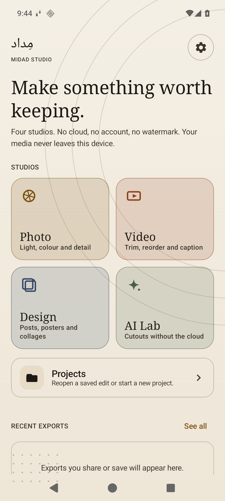
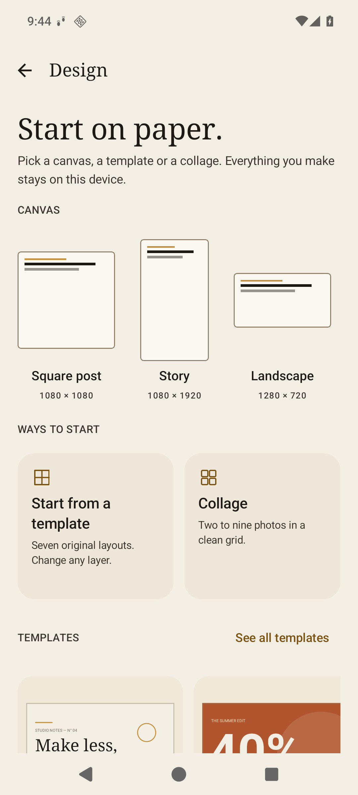
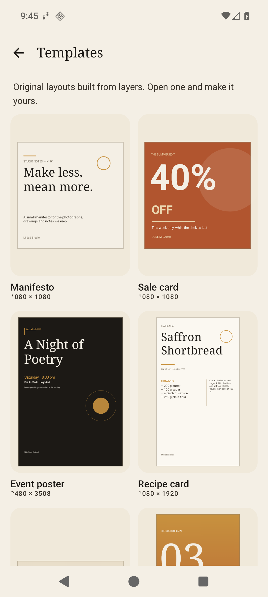
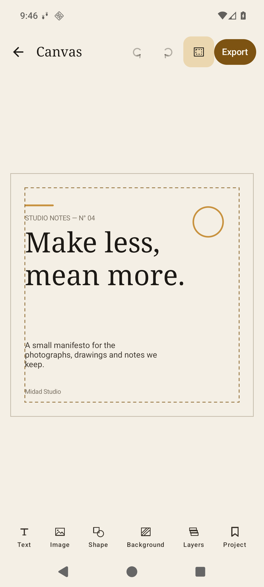
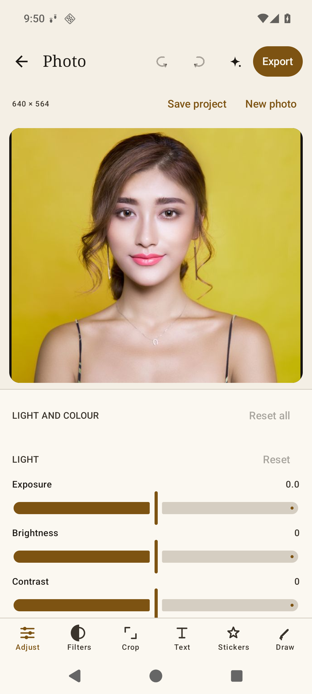
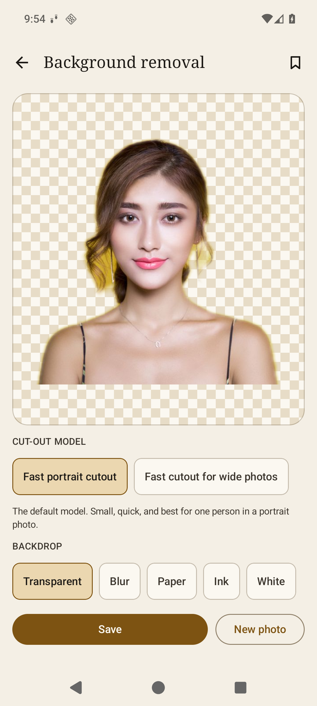
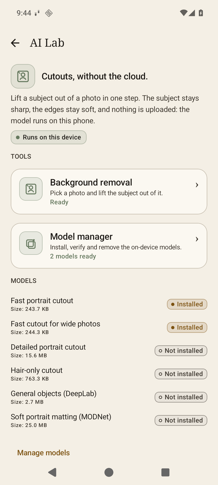

<div align="center">

# Midad Studio — استوديو مِداد

**A private, offline-first creative studio for Android: photo editing, collage and design, video editing, and on-device AI background removal — in one app, with no account, no ads and no uploads.**

[](https://developer.android.com/about/versions/oreo)

[](https://github.com/ahmadmhmdsy/midad-studio/releases/tag/v0.2.3)
[](LICENSE)
[](https://github.com/ahmadmhmdsy/midad-studio/releases)

[English](README.md) · [العربية](README.ar.md)

</div>

> [!IMPORTANT]
> **Pre-release: v0.2.3, not on Google Play.** This is a **signed, self-distributed pre-release build** (versionCode 5,
> built 22 November 2026). **It is not on Google Play yet and nothing has been submitted to Play Console.** It has been
> tested on Android emulators, **not on a physical device**, and "Midad Studio / استوديو مِداد" is a **working title**.
> Install it from [GitHub Releases](https://github.com/ahmadmhmdsy/midad-studio/releases).

## What is Midad Studio?

Midad Studio is a **private, offline photo editor for Android** that also carries a video editor, a collage maker,
a design/template studio and an **on-device AI background remover** — one app instead of five. *Midad* (مِداد) is
Arabic for ink, and the app is built around a paper-and-ink workspace: warm paper, deep ink and four muted accents.

Everything that edits, renders or exports runs **on your phone**. The interface is **Arabic-first** — a real Arabic
photo editor with right-to-left layout, Arabic text layers and locale-aware number formatting, not a translation
bolted on — with a full English translation. On top of the studios sit **editable projects**, a model manager for the
AI lab, and one shared **export result card** that tells you where your file went. The stack is Kotlin + Jetpack
Compose, Media3 Transformer for video export and LiteRT for on-device inference.

## Contents

- [What is Midad Studio?](#what-is-midad-studio)
- [Features](#features)
- [Screenshots](#screenshots)
- [Download and install](#download-and-install)
- [Privacy and data safety](#privacy-and-data-safety)
- [Build from source](#build-from-source)
- [Architecture](#architecture)
- [Known limitations](#known-limitations)
- [FAQ](#faq)
- [Contributing and security](#contributing-and-security)
- [Licence](#licence)
- [Links](#links)

## Features

### Four studios and one AI lab

| Studio | What you can do |
|---|---|
| **Photos** (photo editor) | Exposure, contrast, highlights, shadows, temperature, saturation and detail; original film-style looks; crop, rotate and straighten; Arabic and English text layers, stickers and freehand drawing; undo/redo; JPEG or PNG export with a chosen long edge (Original, 2048 or 1080 px). |
| **Video** (video editor) | Up to 5 clips and 3 minutes per project; trim and reorder clips, apply a colour look and frame ratio, add a title, and export an MP4 on the device with Media3. The full-project preview plays the exact composition the exporter writes, using a 960 px proxy for playback. |
| **Design** (design studio) | Blank canvases (post, story, landscape, A4) and **7 original layered templates** — manifesto, sale card, event poster, recipe card, minimal label, story countdown and title card. Add image, text and shape layers; move, scale and rotate them; export PNG or JPEG. |
| **Collage** (collage maker) | Build a collage from your photos with layouts and paper gutters, then export the whole grid once. |
| **AI Lab** (AI background remover) | Remove, blur or replace the background of a photo **on the device** with a six-model catalogue: two models bundled for offline use and four optional downloads. |
| **Projects** | Save, reopen, rename and delete an editable session in Photo, Design, AI cut-out or Video. Projects are local and app-private; video projects keep the 5-clip / 3-minute cap. |
| **Export result card** | After every export, one card shows a preview, the file name, where it was saved and **Open / Share / Close** — the same surface in every studio. |

### On-device AI models

Two models are bundled so background removal works **offline out of the box**; the other four are downloaded only
when you ask for them. Every model is licensed for this use and is checked against a SHA-256 hash before it is
loaded.

| Model | Where it comes from | Size | Best for |
|---|---|---|---|
| MediaPipe Selfie Segmenter (square) | Bundled in the APK | 243.7 KB | People against a clear background |
| MediaPipe Selfie Segmenter (landscape) | Bundled in the APK | 244.3 KB | The same, for landscape framing |
| MediaPipe Selfie Multiclass | Download | 15.6 MB | People plus hair, skin and clothing classes |
| MediaPipe Hair Segmenter | Download | 763.3 KB | Hair only |
| DeepLab-V3 | Download | 2.78 MB | General objects, pets, products and scenery — not portraits |
| MODNet portrait matting | Download | 24.96 MiB | Portraits with soft hair edges — portraits only |

Downloads are a plain HTTPS <code>GET</code> that you start, with no account, device identifier or usage event
attached; each file is verified before use and stored in app-private storage. Nothing is downloaded in the
background, and no model ever leaves the device. Details:
[docs/research/MODEL_CATALOGUE.md](docs/research/MODEL_CATALOGUE.md) and
[docs/product/MODEL_LICENSES.md](docs/product/MODEL_LICENSES.md).

## Screenshots

| Home | Design | Templates | Canvas editor |
|---|---|---|---|
|  |  |  |  |
|  |  |  | |

*Screens captured from the signed v0.2.3 release build on an API 36 emulator (English UI, light theme). The portrait in the photo-editor and cut-out frames is a third-party demonstration image used for testing; it is not bundled with the app and is not covered by the project licence. An Arabic-UI set from the 0.2.0 pre-release is in [docs/store/screenshots/](docs/store/screenshots/); provenance and hashes for both sets are in the [store guide](docs/store/README.md) and [screenshots-v023/README.md](docs/store/screenshots-v023/README.md).*

## Download and install

The only official download is the **signed APK attached to the [v0.2.3 GitHub release](https://github.com/ahmadmhmdsy/midad-studio/releases/tag/v0.2.3)**.
**Google Play: not yet** — the app has not been submitted to Play Console, so no Play Store listing exists.

| Asset | What it is | Size | SHA-256 |
|---|---|---|---|
| [Midad-Studio-0.2.3-release.apk](https://github.com/ahmadmhmdsy/midad-studio/releases/latest/download/Midad-Studio-0.2.3-release.apk) | Signed APK — the file you install | 22,072,532 bytes (≈21.1 MiB) | <code>AA7674D51EB1A966A9714B14DFEA635DB8DA079D88E84E159FE70D8B4D2FA76D</code> |
| Midad-Studio-0.2.3-release.aab | Signed Android App Bundle — for store tooling, not directly installable | 15,480,566 bytes (≈14.8 MiB) | <code>5BF7B419DB0370ABE34F3E7091BB083BE246C2CA14B1DD0B04C77BEDD17EF903</code> |

**Requirements:** Android 8.0 (API 26) or newer; arm64-v8a, armeabi-v7a or x86_64 device. The APK is signed and not
debuggable.

1. Download <code>Midad-Studio-0.2.3-release.apk</code> from the release page.
2. Check the file against the SHA-256 above: <code>sha256sum Midad-Studio-0.2.3-release.apk</code> on Linux/macOS,
   or <code>Get-FileHash Midad-Studio-0.2.3-release.apk -Algorithm SHA256</code> in PowerShell.
3. Open the file on the phone and confirm the install. Android asks you to allow installing from your browser or
   file manager the first time; approve the prompt.
4. Over USB, install from a computer:

```bash
adb install -r Midad-Studio-0.2.3-release.apk
```

Uninstalling removes the app's local data; projects are not backed up or transferred.

## Privacy and data safety

- **One permission: <code>INTERNET</code>.** It is used for exactly one purpose — an optional AI-model download that
  you start yourself. The app requests no camera, microphone, location, contacts or storage permission; media is
  opened through Android's Photo Picker and exported through MediaStore.
- **Your media stays on your phone.** Photos and videos are never uploaded: there is no account, no sign-in, no cloud
  sync, no ads, no analytics, no telemetry and no watermark on exports.
- **No background traffic.** The only network requests the app can make are the model downloads you initiate, to
  fixed HTTPS hosts. They carry no photo, file name, device identifier or usage event, and every file is verified
  against its SHA-256 before use.
- **Backup and device transfer are off.** <code>allowBackup="false"</code> plus Android 12+ data-extraction rules
  exclude the app's data, so it is not copied to Google Drive or moved to a new phone by the system.
- **Projects are private too.** Project payloads and thumbnails live in the app-private
  <code>noBackupFilesDir/projects</code> directory; no project can be exported, shared or synced.

The privacy policy is a public page at [ahmadmhmdsy.github.io/midad-studio/privacy](https://ahmadmhmdsy.github.io/midad-studio/privacy/) and lives in the repo at
[docs/product/PRIVACY_POLICY.md](docs/product/PRIVACY_POLICY.md) (English and Arabic), with the Play Data safety answer key in
[docs/product/DATA_SAFETY.md](docs/product/DATA_SAFETY.md).

## Build from source

### Requirements

- **JDK 17 or newer** — the code targets Java 17 bytecode; the CI workflow uses Temurin JDK 21.
- **Android SDK** platform **36** and build-tools **36.0.0** (<code>compileSdk</code>/<code>targetSdk</code> 36,
  <code>minSdk</code> 26).
- **Gradle 8.11.1** — the wrapper pins it, so no separate install is needed; PowerShell 7 is only needed for the
  local release gate. The project contains no native code of its own.

### Commands

```bash
# Debug build — no signing secrets required
./gradlew :app:assembleDebug --console=plain

# Unit tests and JVM lint
./gradlew :app:testDebugUnitTest :app:lintDebug --console=plain

# Release build — needs the untracked keystore.properties + upload keystore
./gradlew :app:assembleRelease :app:bundleRelease --console=plain
```

On Windows use <code>gradlew.bat</code> instead of <code>./gradlew</code>.

### Signing

The release signing config is read from **<code>keystore.properties</code>**, which is untracked and holds
<code>storeFile</code>, <code>storePassword</code>, <code>keyAlias</code> and <code>keyPassword</code>; the keystore
itself is in the untracked <code>keystore/</code> folder. Release tasks fail fast when that file is missing, so a
release build can never be silently unsigned. The published APK and AAB are signed with the project's upload key —
to build your own evaluation copy, use your own keystore. See [LICENSE](LICENSE) for what you may do with a build.

### Verification

The 0.2.3 tree passes **94 unit tests across 20 suites** (0 failures), the instrumented suite runs **5/5 on each of
two API 36 emulators**, and <code>lintRelease</code> reports **0 errors / 62 warnings / 3 hints**, all triaged. The
local release gate (<code>tools/release-check.ps1</code>) verifies signature, version, permission set, debuggable
flag and 16 KB ELF alignment, and the APK is a single <code>classes.dex</code> with 9 native libraries. Build
evidence: [docs/qa/BUILD_REPORT.md](docs/qa/BUILD_REPORT.md). CI runs unit tests and lint on every push and pull
request ([workflow](.github/workflows/android.yml)).

## Architecture

A single-activity **Kotlin + Jetpack Compose** app organised by studio, with the shared machinery in <code>core/</code>:

```text
app/src/main/java/com/midad/studio/
├── core/
│   ├── ai/        model manifest, HTTPS download + SHA-256 check, LiteRT interpreter, mask compositing
│   ├── export/    MediaStore and FileProvider export pipeline with typed outcomes
│   ├── draft/     serialised in-progress sessions for each studio
│   ├── project/   project index, thumbnails, save/reopen/rename/delete
├── studio/
│   ├── photo/     editor, adjustment engine, layers, JPEG/PNG exporter
│   ├── video/     clip timeline, Media3 composition, Transformer export, full-project preview
│   ├── design/    canvas model, 7 layered templates, collage, renderer, export
│   └── ai/        AI Lab screens: remove / blur / replace background
├── ui/            shared components, paper-and-ink theme, Arabic number formatting
└── MainActivity.kt · MidadApp.kt   (+ projects/, settings/, home/, navigation/)
```

The AI layer is manifest-driven: each model's input layout, preprocessing and activation are declared in
<code>assets/models/manifest.json</code> rather than assumed, and downloads are verified against the same manifest.
Video export composes clips with Media3 Transformer; the full-project preview reuses the exporter's own
<code>Composition</code>, so what you preview is what gets written. Exports go through MediaStore into
<code>Pictures/Midad</code> and <code>Movies/Midad</code>, with a legacy app-storage path for Android 8–9.

## Known limitations

These are real limits of the current build, not future plans:

- **Exports are flattened.** Camera EXIF metadata and the original colour profile are not preserved.
- **"Largest" export is capped** at 3200 px on the long edge.
- **Video projects are capped** at 3 minutes and 5 clips; the full-project preview is a 960 px proxy (export quality
  is unaffected).
- **Limits that come from the models.** MODNet is portraits-only; DeepLab-V3 is for general objects, not portraits.
- **No project portability.** No cloud sync, no project-file share or export, and no project transfer between
  devices.
- **No real-device QA yet.** Acceptance testing has run on emulators (API 26/28/29/36) only.
- **Not on Google Play.** Nothing has been submitted to Play Console.

## FAQ

**Is Midad Studio on Google Play?** No. v0.2.3 is distributed as a signed APK from GitHub Releases, and nothing has been submitted to Play Console yet.

**Does it work offline?** Yes. Editing, AI cut-outs and exports work with no network connection. The only network use is an optional AI-model download that you start from the model manager.

**Do my photos or videos leave my phone?** No. There is no account, cloud sync, analytics or telemetry; media is opened through Android's Photo Picker, edited on the device and saved through MediaStore, and downloads carry no photo, file name or identifier.

**Does it cost anything? Are there ads?** This pre-release build is free to download and contains no ads, no in-app purchases and no advertising SDK.

**Why does Android warn when I install the APK?** Because the APK is distributed directly rather than through Play, Android asks you to allow installing from an unknown source. Check the SHA-256 first, then allow your browser or file manager to install it.

**Which Android versions are supported?** Android 8.0 (API 26) and newer, with targetSdk 36. Acceptance has run on emulators at API 26/28/29/36; real-device testing is still pending.

**What are the export limits?** Image exports offer Original, 2048 px or 1080 px on the long edge, and the Original option is capped at 3200 px. Video projects are capped at 5 clips and 3 minutes, and this version has no music library or audio import.

**Can I move a project to another phone?** No. Projects are local and app-private, with no sync, export or transfer between devices.

## Contributing and security

Bug reports, feature requests and pull requests are welcome. Start with [CONTRIBUTING.md](CONTRIBUTING.md) and
[CODE_OF_CONDUCT.md](CODE_OF_CONDUCT.md), and open an issue at
[github.com/ahmadmhmdsy/midad-studio/issues](https://github.com/ahmadmhmdsy/midad-studio/issues). Please report
security issues as described in [SECURITY.md](SECURITY.md) rather than in a public issue.

## Licence

**Source available, all rights reserved.** The source is published so people can read, study and evaluate it — but
this is **not an open-source licence**. No permission is granted to redistribute the app or publish builds or
derivatives; reading, studying, personal non-commercial evaluation builds, short attributed quotations and
issues/pull requests are allowed. The full terms are in [LICENSE](LICENSE).

Third-party components keep their own licences. AndroidX, Kotlin, Jetpack Compose, Media3, LiteRT and the AI models
are mostly Apache-2.0; their notices are reproduced in [THIRD_PARTY_NOTICES.md](THIRD_PARTY_NOTICES.md), the model
licence matrix [docs/product/MODEL_LICENSES.md](docs/product/MODEL_LICENSES.md), the verbatim texts in
[docs/product/licenses/](docs/product/licenses/) and the in-app viewer under Settings → Licences.

No trademark rights are granted. "Midad Studio" and "استوديو مِداد" are used as a working title.

## Links

| | |
|---|---|
| Website | [ahmadmhmdsy.github.io/midad-studio](https://ahmadmhmdsy.github.io/midad-studio/) |
| Arabic website | [ahmadmhmdsy.github.io/midad-studio/ar](https://ahmadmhmdsy.github.io/midad-studio/ar/) |
| Privacy policy | [ahmadmhmdsy.github.io/midad-studio/privacy](https://ahmadmhmdsy.github.io/midad-studio/privacy/) |
| Releases | [github.com/ahmadmhmdsy/midad-studio/releases](https://github.com/ahmadmhmdsy/midad-studio/releases) |
| Release v0.2.3 | [github.com/ahmadmhmdsy/midad-studio/releases/tag/v0.2.3](https://github.com/ahmadmhmdsy/midad-studio/releases/tag/v0.2.3) |
| Issues | [github.com/ahmadmhmdsy/midad-studio/issues](https://github.com/ahmadmhmdsy/midad-studio/issues) |
| Documentation | [docs/README.md](docs/README.md) |
| Maintainer | [github.com/ahmadmhmdsy](https://github.com/ahmadmhmdsy) |

<div align="center">

**[English](README.md) · [العربية](README.ar.md)**

© 2026 Ahmad Mahmoud. All rights reserved. Midad Studio is a working title.

</div>
